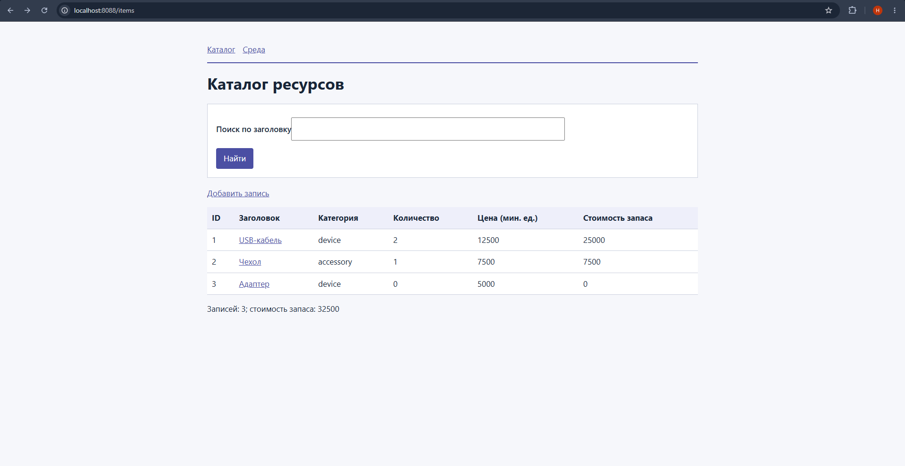
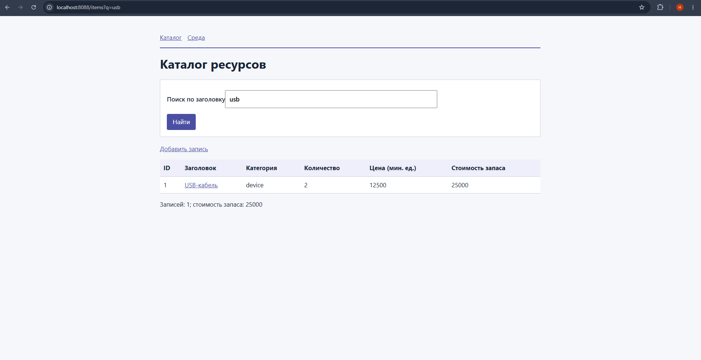
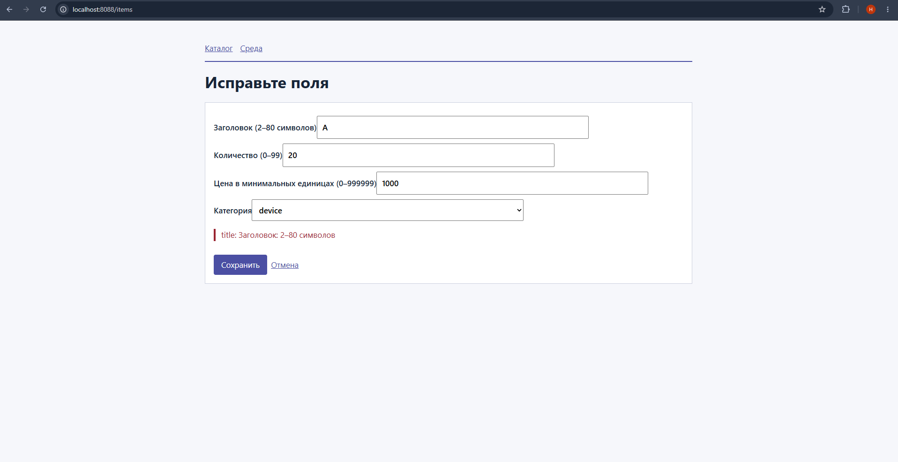
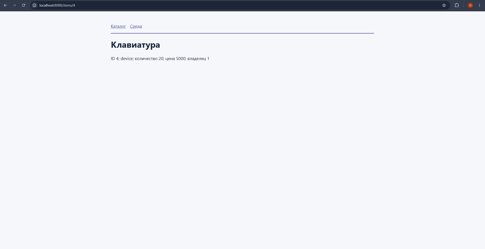
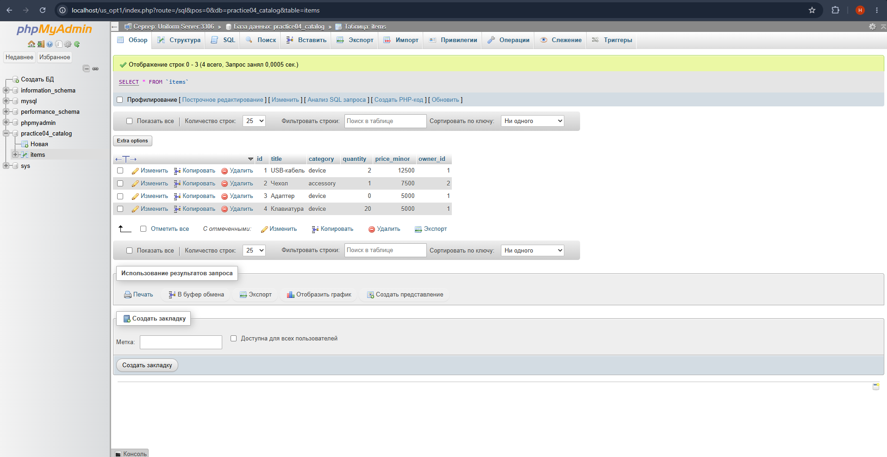
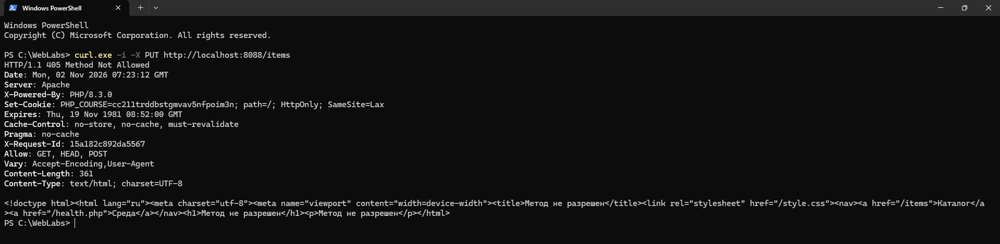

# Практическая работа № 4: маршруты, контроллер и MySQL

**Студент:** Фёдоров Никита, группа CS-304(с)
**Вариант:** A (техника)

## Среда

| Компонент | Версия или путь |
|---|---|
| Uniform Server | 15.0.1 |
| PHP (Apache, из `/health.php`) | 8.3.0 |
| PHP CLI (`php -v`) | 8.3.0 |
| Composer (`composer --version`) | 2.6.5 |
| Сервер БД (`SELECT VERSION();` в phpMyAdmin) | 8.4.3 |
| Папка проекта | C:\WebLabs\pr04 |
| Веб-корень Apache | C:\WebLabs\pr04\public |

## Запуск

1. Импорт в phpMyAdmin: `sql/schema.sql`, затем `sql/variant_A.sql`.
2. `config.local.php` создан из `config.example.php` (пароль в README не указывается).
3. `composer install`
4. Подключение `Include "C:/WebLabs/php-course.conf"` в конфигурационный файл Apache `httpd.conf`.

## Снимки экрана

**Каталог своего варианта** (`/items`, три исходные записи и добавленные вами):

**Поиск** (`/items?q=usb`):

**Ошибка формы** (заголовок из одного символа, ответ 422 с сообщением):

**Созданная запись** (страница `/items/<id>` после сохранения формы):

**Таблица `items` в phpMyAdmin** с той же записью:

**Network в браузере или `curl.exe -i`:** ответ 405 с заголовком `Allow` и `X-Request-Id`:

## Самопроверка

Результат `php bin/self-check.php`: [self-check-result.md](self-check-result.md). Пройдено 23 из 23.

## Что было трудным

При настройке маршрутизатора возникла сложность с корректной обработкой HTTP-методов и заголовка Allow для несуществующих методов. Разобравшись с логикой метода dispatch в роутере и корректным сбором разрешенных методов, удалось успешно пройти все тесты автоматической самопроверки.